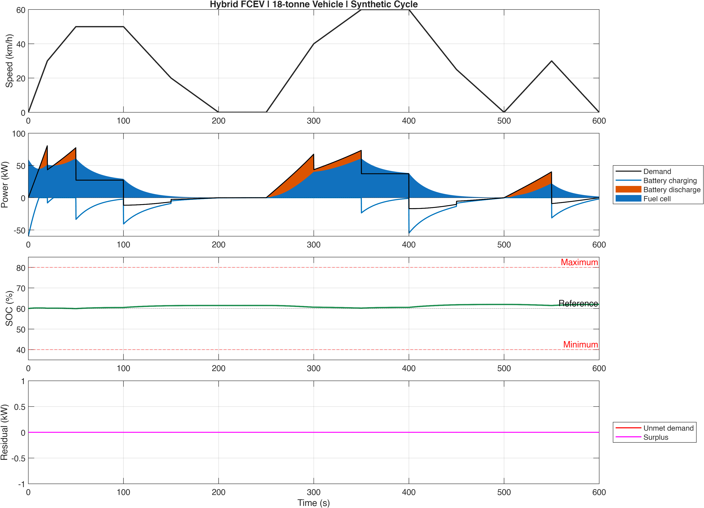
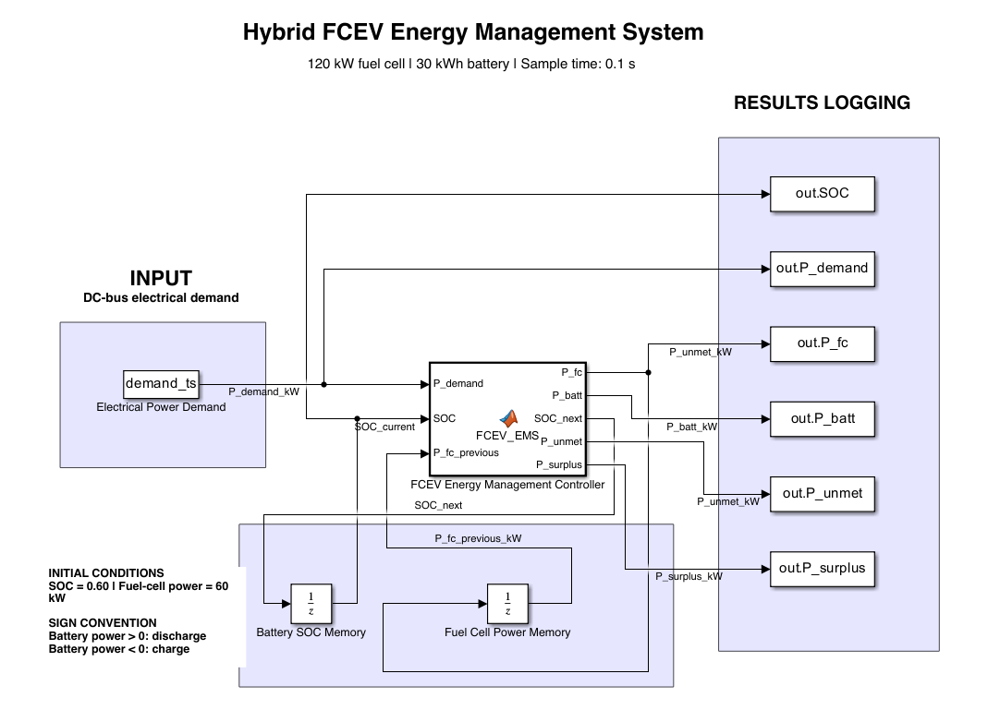
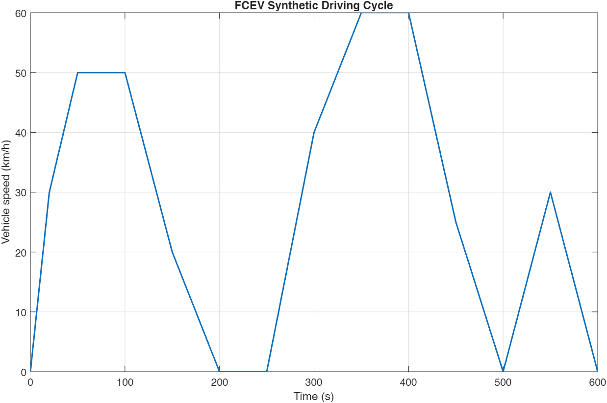
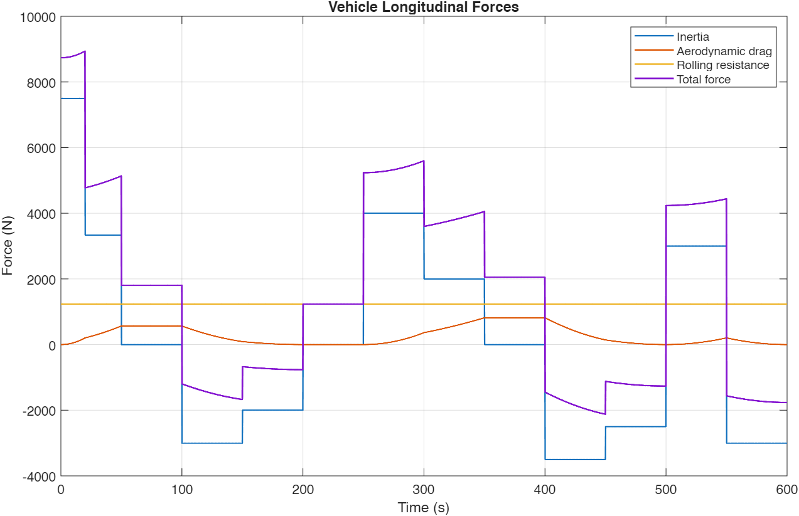
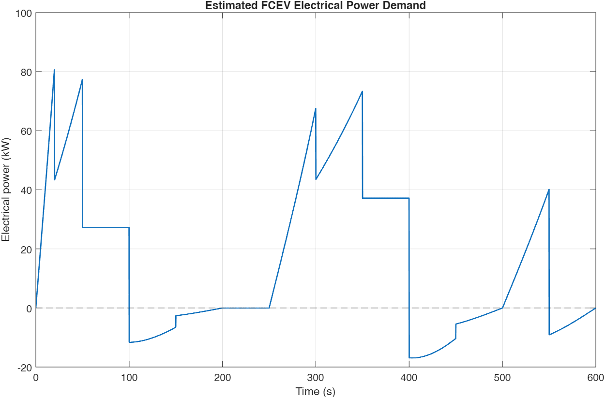

# Hybrid FCEV Energy Management

**From vehicle speed to power sharing: a MATLAB/Simulink study of an 18-tonne hybrid fuel-cell vehicle.**

Author: **Mohammad Rayhanul Haque** | [GitHub profile](https://github.com/rayhaq-au)



## Objective

Investigate how a 120 kW fuel-cell source and a 30 kWh battery share electrical demand while keeping battery state of charge (SOC) between 40% and 80%.

The fuel cell changes its output gradually. The battery supplies the remaining power and absorbs energy from braking or excess fuel-cell output. SOC feedback adjusts the fuel-cell target.

This is a **backward-facing, power-based simulation with a synthetic driving cycle**, not a validated production-vehicle model.

## Model



The source diagram's wire feeding `out.P_fc` is labeled `P_unmet_kW`. This is a cosmetic naming issue: that wire is fuel-cell power and the logged variable is `P_fc`. The project-summary PDF corrects the presentation label.

### Calculation flow

1. Prescribed speed defines acceleration, cruising and braking.
2. Inertia, aerodynamic drag and rolling resistance determine wheel force.
3. Force multiplied by speed gives wheel power.
4. Drivetrain efficiencies convert wheel power into electrical demand.
5. The EMS splits power between the fuel cell and battery.
6. Discrete feedback updates SOC and previous fuel-cell power every 0.1 s.

## Requirements and running

- MATLAB and Simulink. The supplied model is saved in **R2025b**.
- Plotting uses `theme`, available from MATLAB R2025a. Earlier releases have not been tested, and the model may need export from a newer release.
- This version does not use a detailed Simscape physical network.

Choose **Code > Download ZIP**, extract it, and set MATLAB's Current Folder to the extracted project folder. Run this from the MATLAB Command Window:

```matlab
run_project
```

Setup clears workspace variables and closes existing figures. Run in the base workspace, not inside a function. Avoid adding older copies of the model or scripts to the MATLAB path.

New results go to `results/FCEV_results.png` and `results/FCEV_results.mat`. Images under `images/` are the original documented demonstration and are not automatically replaced by a new run.

## Parameters

| Parameter | Value |
|---|---:|
| Vehicle mass | 18,000 kg |
| Maximum fuel-cell power | 120 kW |
| Initial fuel-cell power | 60 kW |
| Fuel-cell ramp limit | 10 kW/s |
| Controller smoothing time constant | 20 s |
| Battery capacity | 30 kWh |
| Battery discharge / charge limits | 100 / 60 kW |
| Initial / reference SOC | 60% / 60% |
| SOC limits | 40-80% |
| Motor / regeneration efficiency | 0.92 / 0.70 |
| Battery efficiency per direction | 0.95 |
| Sample time | 0.1 s |

**Parameter synchronization:** the MATLAB Function block has its own EMS constants. Editing `FCEV_setup.m` alone does not change those embedded values. Keep shared parameters consistent. `reference/FCEV_EMS.m` is an extracted readable snapshot, not the function automatically executed by the model.

## Documented results

These values are from the author's completed MATLAB/Simulink demonstration. Packaging did not rerun MATLAB.

| Metric | Result |
|---|---:|
| Cycle duration | 600 s |
| Distance | 4.72 km |
| Maximum speed | 60 km/h |
| Initial / final SOC | 60.00% / 62.03% |
| Minimum / maximum SOC | 59.95% / 62.03% |
| Fuel-cell electrical energy | 3.384 kWh |
| Battery discharge at bus | 0.622 kWh |
| Battery charging at bus | 1.329 kWh |
| Unmet-demand energy | 0 kWh |
| Surplus energy | Approximately 0 kWh |
| Maximum power-accounting residual | 3.553e-15 kW |

The battery gained approximately 0.609 kWh of stored energy. This run is net charging. Fair strategy comparisons must account for final battery-energy differences.

`FCEV_results.m` checks signal alignment, SOC limits, power limits, ramp rate, SOC integration and power accounting:

```text
P_fc + P_batt + P_unmet = P_demand + P_surplus
```

Positive battery power means discharge; negative means charge. Charging energy includes fuel-cell charging and recovered braking energy.

## Input and calculated demand





## Scope and limitations

- Vehicle speed is prescribed; actual speed is not calculated if power is insufficient.
- The cycle is synthetic, not measured or official WLTP data.
- Parameters are assumptions, not calibrated production-vehicle specifications.
- Fuel-cell response comes from controller smoothing and ramp limits. No stack electrochemistry, hydrogen consumption, air supply, thermal behavior or degradation is modeled.
- Battery voltage, current, temperature and degradation are absent; efficiency is fixed.
- Flat road, no auxiliary loads, and constant drivetrain efficiencies.
- Rolling resistance is constant, including at rest, where its power contribution is zero.
- Power accounting and enforced limits do not constitute physical validation or proof of controller optimality.
- The minimum fuel-cell power applies to a positive target; output can pass below it during simplified transitions.
- Nonzero surplus requires physical handling; rejected regeneration and excess fuel-cell output are not separately identified in this version.

## Files

| File | Purpose |
|---|---|
| `run_project.m` | Run complete workflow |
| `FCEV_setup.m` | Vehicle/system parameters |
| `FCEV_drivecycle.m` | Speed and acceleration |
| `FCEV_vehicle_dynamics.m` | Road load and electrical demand |
| `FCEV_Hybrid_Powertrain_EMS.slx` | EMS and state feedback |
| `FCEV_results.m` | Numerical checks and figures |
| `reference/FCEV_EMS.m` | Embedded-controller snapshot |
| `docs/project_summary.pdf` | Six-page visual summary |

## Next steps

Introduce authentic bus duty data, road grade and auxiliary loads; assess long-term SOC behavior; compare EMS strategies; calibrate against component and vehicle measurements.

[Read the illustrated project summary](docs/project_summary.pdf)
